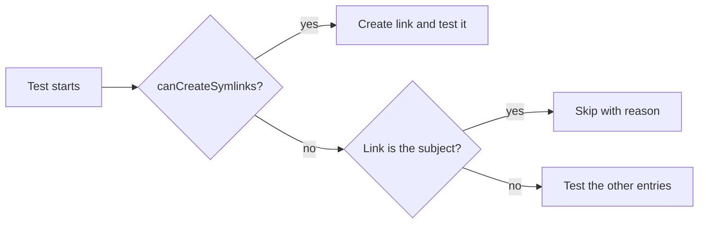

<!--
@license
Copyright (c) ggsuite

Use of this source code is governed by terms that can be
found in the LICENSE file in the root of this package.
-->

# Run gg Checks on Windows Without Symlink Rights

## Motivation

- gg should work for every developer, on macOS, Linux and Windows alike
- Several tests created symbolic links as fixtures
- On Windows, creating a symbolic link needs Developer Mode or admin rights
- Without them, `gg do push` of ticket gg-1 failed with the error
  "Dem Client fehlt ein erforderliches Recht"
- The goal: the checks pass on a plain Windows machine, while macOS and
  Linux keep testing every link case

## Strategy

- Probe once whether the machine can create symbolic links
- Skip tests whose subject is a symbolic link when it cannot
- Keep tests running where a link is only one entry among others
- Mark the link branches of the production code as coverage-ignored
- Leave the behavior of gg itself unchanged

## Symlink Probe

- New helper file `test/symlinks.dart`
- `canCreateSymlinks` creates a link in a temp folder once and remembers
  whether that worked
- `skipWithoutSymlinks` is `false` when links work, otherwise a reason
- Tests pass it to `skip:`, so the reason shows up in the test output

## Tests About Links

- Some tests check the link handling itself
- `copyDirectory` copies symlinks as symlinks
- `copyDirectory` copies a broken symlink
- Both skip with `skipWithoutSymlinks` when links cannot be created

## Tests With a Link Among Others

- Other tests used a link only as one of several entries
- Trash `moveFromTicket` falls back to copy + delete
- `WorkspaceUtils` refuses a place taken by something that is no ticket
- These tests now create the link only where possible
- They still run on every machine and check the remaining entries

## Coverage

- Windows tests reach the link branches in Developer Mode only
- Without it, the coverage check would fail on those lines
- The link branches got coverage-ignore markers:
  - `copyDirectory` in `filesystem_utils.dart`
  - `_copy` in `trash.dart`
  - a link in place of a ticket in `workspace_utils.dart`
- On macOS and Linux the tests still run through these branches

## Result

- `gg one can commit` passes on Windows without Developer Mode
- On macOS and Linux all link tests still run
- No change to how gg handles links at runtime

## Open Points

- Link handling on Windows is only tested in Developer Mode
- The coverage-ignored branches rely on macOS and Linux runs
