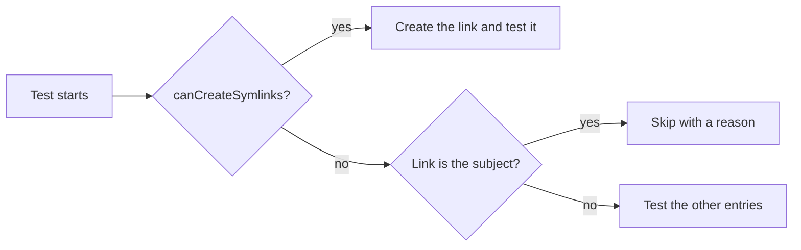

<!--
@license
Copyright (c) ggsuite

Use of this source code is governed by terms that can be
found in the LICENSE file in the root of this package.
-->

# Pass the checks on Windows without symlink rights

## Motivation

- The checks of this repo should pass on every developer machine, on
  macOS, Linux and Windows alike
- Several tests used symbolic links as fixtures
- Windows creates symbolic links only in Developer Mode or with
  administrator rights
- Without them, these tests failed with "A required privilege is not held
  by the client", and `gg one can commit` stopped
- Goal of ticket gg-1: the checks pass on a plain Windows machine, while
  macOS and Linux keep testing every link case

## Strategy

- Probe once per test run whether the machine can create symbolic links
- Skip a test whose subject is a symbolic link where it cannot
- Keep a test running where a link is only one entry among others
- Exclude the link branches of the code from coverage
- Leave the runtime behavior of the package unchanged

## Implementation 1: Symlink probe

- New test helper `test/symlinks.dart`
- `canCreateSymlinks` creates a link in a temp folder once and keeps the
  result for the whole test run
- `skipWithoutSymlinks` is `false` where links work, otherwise the reason
- Tests pass it to `skip:`, so the reason shows up in the test output

## Implementation 2: Tests with links

- `copyDirectory`: "copies symlinks as symlinks" and "copies a broken
  symlink instead of dropping it" skip without symbolic links
- `Trash.moveFromTicket`: "falls back to copy + delete when rename fails"
  adds its link only where possible and checks the other files everywhere
- `WorkspaceUtils`: "throws for a place taken by something that is no
  ticket" counts the link as a taken place only where one was created

## Implementation 3: Coverage

- Windows tests reach the link branches in Developer Mode only, so the
  coverage check would fail on a plain machine
- These branches got `coverage:ignore` markers:
  - `copyDirectory` in `filesystem_utils.dart`
  - `Trash._copy` in `trash.dart`
  - a link in place of a new ticket in `workspace_utils.dart`
- On macOS and Linux the tests still run through these branches

## Dependency updates

- `dna_ggsuite` moves from `^0.5.0` to `^1.0.0`; the regenerated guides
  and skills bring:
- A `/gg-review` skill: blog posts and the README are written before the
  pull requests, no longer at publish time
- Claude Code hooks that keep the prompts of a ticket in its project
  management repo
- New rules in the AI guide: keep every repo in its scope, keep
  `index.jsonc` up to date, describe every repo in its own terms
- Type names in the code guides no longer carry a package prefix

## Result

- The checks of this repo pass on Windows without Developer Mode
- On macOS and Linux all link tests still run
- The package handles links at runtime as before

## Open Points

- Link handling on Windows is tested in Developer Mode only
- The coverage-ignored branches rely on the macOS and Linux runs
